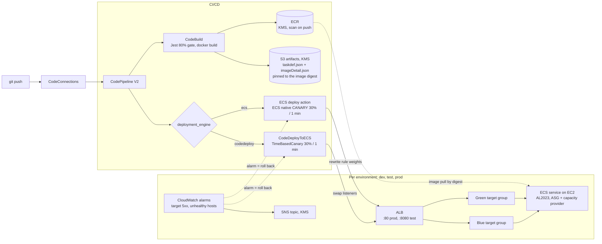
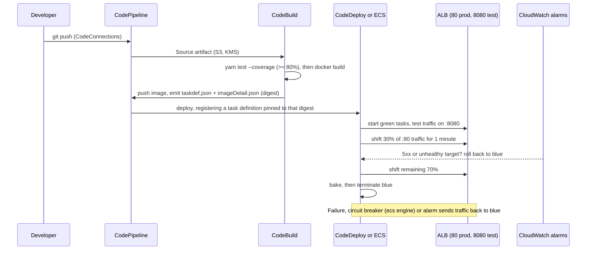

# Blue-Green Deployment with AWS Terraform

[](https://github.com/Sagargupta16/terraform-aws-ecs-blue-green/actions/workflows/ci.yml)
[](https://sonarcloud.io/summary/new_code?id=Sagargupta16_Blue_Green_AWS_Terraform)
[](LICENSE)

Infrastructure-as-Code for a multi-environment Blue/Green deployment pipeline on AWS. A single `terraform apply` provisions the network, registry, CI/CD, and three isolated ECS environments (dev, test, prod) for a containerized Node.js reference app.

**Why it exists:** shipping a new container version without downtime, with a way to test it on real infrastructure before users see it, and an automatic way back when it breaks. The new version runs next to the old one, gets 30% of production traffic for a minute, then takes over, or traffic goes back to the old version when a 5xx or health alarm fires.

**Two blue/green engines, one variable.** `deployment_engine = "codedeploy"` (default) uses CodeDeploy and the `CODE_DEPLOY` controller. `deployment_engine = "ecs"` uses the [ECS built-in blue/green and canary deployments](https://aws.amazon.com/about-aws/whats-new/2025/07/amazon-ecs-built-in-blue-green-deployments/) (GA July 2025): no CodeDeploy at all, ECS shifts the listener-rule weights itself and rolls back on its circuit breaker or the same alarms.

**Build once, deploy that digest.** Each build renders `taskdef.json`, `imageDetail.json` and `imagedefinitions.json` with the pushed image's `sha256` digest, so test and prod run the exact image the build tested, even if another build lands while prod waits for approval.

## Architecture

<picture>
  <source media="(prefers-color-scheme: dark)" srcset="docs/diagrams/runtime-dark.svg">
  <source media="(prefers-color-scheme: light)" srcset="docs/diagrams/runtime-light.svg">
  
</picture>

<picture>
  <source media="(prefers-color-scheme: dark)" srcset="docs/diagrams/pipeline-dark.svg">
  <source media="(prefers-color-scheme: light)" srcset="docs/diagrams/pipeline-light.svg">
  
</picture>

The specs behind the pictures are [`docs/diagrams/runtime.yaml`](docs/diagrams/runtime.yaml) and [`docs/diagrams/pipeline.yaml`](docs/diagrams/pipeline.yaml), rendered with [orrery](https://github.com/Sagargupta16/orrery).

<details>
<summary>Both engines in one Mermaid flowchart</summary>



</details>

- **ECS on EC2**: containerized application hosting with an Auto Scaling Group of Amazon Linux 2023 container-instances (one cluster per environment)
- **Application Load Balancer**: per-environment ALB with two target groups (blue/green) and two listeners (`:80` prod traffic, `:8080` test traffic). With the `ecs` engine each listener also gets a weighted rule that ECS shifts
- **Auto Scaling Group + ECS Capacity Provider**: managed-scaling EC2 capacity for each cluster
- **CodePipeline (V2)**: two pipelines (`dev`, `main`) triggered by GitHub push via a CodeConnections (formerly CodeStar Connections) connection
- **CodeBuild**: Jest tests with an 80% line-coverage gate, Docker image build, ECR push, and the digest-pinned deploy artifacts ([`scripts/render-deploy-artifacts.sh`](scripts/render-deploy-artifacts.sh))
- **CodeDeploy** (`codedeploy` engine): `CodeDeployToECS` action with a custom `TimeBasedCanary` config (30% traffic for 1 min, then full cutover); rolls back on deployment failure or on a rollback alarm
- **ECS native blue/green** (`ecs` engine): `CANARY` (or `BLUE_GREEN`) deployment strategy with bake time, deployment circuit breaker and alarm rollback, driven by the CodePipeline ECS action
- **CloudWatch alarms**: per environment, target 5xx count and unhealthy targets (worst of blue and green); both engines roll back on them, and every alarm (plus the existing CPU reservation alarm) notifies a KMS-encrypted SNS topic
- **ECR**: KMS-encrypted image registry with scan-on-push
- **VPC**: 2-AZ network, 2 public subnets, 2 private subnets, 2 NAT gateways
- **IAM**: six scoped roles (instance / task execution / task / codebuild / codedeploy / codepipeline), plus an ECS infrastructure role for the `ecs` engine
- **KMS**: single symmetric CMK (key rotation on) shared by ECR, CodeBuild, CodePipeline, CodeDeploy and the alarm topics; its key policy lets CloudWatch publish to the encrypted SNS topics
- **S3**: artifact bucket for CodeBuild/CodePipeline (objects written by the pipeline are encrypted with the CMK)
- **Remote state**: S3 backend with native lock files (`use_lockfile`, no DynamoDB table); [`terraform/bootstrap/`](terraform/bootstrap/) creates the versioned, encrypted, public-access-blocked state bucket and a bucket for its server access logs

## Features

- **Zero-downtime deployments** via ECS blue/green with a 30% canary, on CodeDeploy or ECS native (pick with `deployment_engine`)
- **Build once, promote the digest**: the main pipeline builds once; test and prod both deploy the `sha256` digest that build pushed and tested, through a new task-definition revision per build
- **Alarm-driven rollback**: a target 5xx spike or an unhealthy blue/green target during the canary sends traffic back to blue, on either engine
- **No image without green tests**: tests run before `docker build`, and `on-failure: ABORT` stops CodeBuild before it can push a failed image
- **Tested without an AWS account**: `terraform test` with mocked providers covers both engines, the IAM grants, the pipeline wiring and the user-data shebang regression; tflint with the AWS ruleset runs in CI
- **Per-environment isolation**: dev, test, and prod each get their own ECS cluster, ALB, and ASG
- **KMS-encrypted artifacts end-to-end** (ECR, CodeBuild, CodePipeline, CodeDeploy)
- **Least-privilege IAM**: pipeline role scoped to the services it actually uses (no `ec2:*` / `s3:*` wildcards); execution role and task role are separate identities
- **Consistent tagging** via `provider.default_tags`, no per-resource `tags =` plumbing
- **IMDSv2 enforced** on EC2 container-instances
- **X-Ray distributed tracing** (daemon sidecar + SDK middleware)
- **CI on every PR**: Checkov + `terraform fmt/validate`, `terraform test`, tflint, the Test_App coverage gate and client build, and the deploy-artifact renderer tests
- **Dependency hygiene**: Renovate monthly grouped updates, SonarCloud analysis

## Design decisions

| Decision | Why | Trade-off |
|---|---|---|
| Blue/green, not ECS rolling update | Test listener (`:8080`) lets you hit the new version before any user does; rollback is a traffic shift, not a redeploy | Twice the tasks during a deployment |
| Both CodeDeploy and ECS native blue/green, behind `deployment_engine` | CodeDeploy is what most existing stacks run; ECS native (GA July 2025) drops CodeDeploy and adds the circuit breaker and bake time. Same ALB, alarms and pipeline shape either way | Two code paths to keep tested; the `terraform test` suite runs both |
| 30% canary for 1 min, rollback on alarms | Real production traffic validates the release, and a 5xx spike or unhealthy target aborts it without a human | One minute is short for real traffic; raise `canary_interval_minutes` |
| Deploy artifacts pinned by image digest | `:main-latest` moves with every build; a digest cannot, so prod runs exactly what test ran | One task-definition revision per build (ECS keeps them; deregister old ones if that matters) |
| S3 native lock file, no DynamoDB | Terraform 1.10+ locks state with a lock object in the same bucket, so the bootstrap is one bucket | Needs Terraform 1.10 or newer |
| ECS on EC2, not Fargate | Shows the full container-instance story: launch template, IMDSv2, ASG, capacity provider | More moving parts than Fargate |
| One cluster + ALB per environment | Blast radius of a bad deploy stops at its environment | Three ALBs and six NAT-routed instances cost more than a shared cluster |
| Manual approval between test and prod | A human signs off on what ran in test | Pipeline waits on a person |
| Provider-level `default_tags` | Every taggable resource gets the same tags, no module plumbing | ASG `tag {}` blocks are the one exception AWS forces |
| Hand-rolled modules, no registry modules | Every resource is visible and explainable | More code to maintain than `terraform-aws-modules` |

## Prerequisites

- [Terraform](https://developer.hashicorp.com/terraform/install) >= 1.10 (S3 `use_lockfile`; `terraform test` with mock overrides needs 1.11+). AWS provider `~> 6.0`, pinned by the committed `.terraform.lock.hcl`
- [AWS CLI](https://aws.amazon.com/cli/) configured with credentials for the target account
- [Docker](https://www.docker.com/get-started) for local testing and image builds
- [Node.js](https://nodejs.org/) 20.19+ or 22.12+ for the reference app (Vite 8 needs it; the Dockerfile and `.nvmrc` use Node 24)
- [Yarn](https://classic.yarnpkg.com/) 1.x package manager
- A **CodeConnections** (formerly CodeStar Connections) connection to GitHub, authorized in the AWS console. Its ARN is supplied via `github_connection_arn` in `terraform.tfvars`; existing `arn:aws:codestar-connections:...` ARNs keep working

## Installation

1. **Clone the repository**
   ```bash
   git clone https://github.com/Sagargupta16/terraform-aws-ecs-blue-green.git
   cd terraform-aws-ecs-blue-green
   ```

2. **Configure AWS credentials**
   ```bash
   aws configure
   ```

3. **Customize variables**
   Edit `terraform/terraform.tfvars`. At minimum set `github_connection_arn`, `github_owner`, `github_repo`, `main_branch_name`, `dev_branch_name`. Both branch names must exist in the GitHub repo the connection points at, or the pipelines never trigger. Pick the engine with `deployment_engine` (`codedeploy` or `ecs`).

4. **Create the state bucket (once per account)**
   ```bash
   cd terraform/bootstrap
   terraform init
   terraform apply
   terraform output -raw backend_hcl > ../backend.hcl
   ```

5. **Initialize Terraform against the S3 backend**
   ```bash
   cd ..
   terraform init -backend-config=backend.hcl
   ```
   Already have a local `terraform.tfstate`? Run `terraform init -backend-config=backend.hcl -migrate-state` once and Terraform copies it into the bucket. `backend.hcl` is gitignored; [`backend.hcl.example`](terraform/backend.hcl.example) shows the shape. Never commit state files (they can contain secrets).

## Usage

### Deploy Infrastructure

```bash
cd terraform
terraform plan
terraform apply
terraform output          # prints the three ALB DNS names (dev / test / prod)
```

### Deploy Application

Pushes to the configured branches trigger the pipelines automatically:

- **dev branch** -> `dev` pipeline -> deploys to `dev` environment
- **main branch** -> `main` pipeline -> builds once -> deploys to `test` -> manual approval -> deploys to `prod`

```bash
git push origin <dev_branch_name>   # or main_branch_name
```

The manual approval step happens in the CodePipeline console.

### Local Development (reference app)

```bash
cd Test_App
yarn all-install     # installs backend + frontend, builds React client
yarn start           # starts Express on port 3000 (override with PORT)
yarn test            # Jest + Supertest
```

The app is available at <http://localhost:3000>.

### Switching to ECS native blue/green

Set `deployment_engine = "ecs"` and apply. Terraform then:

- drops the CodeDeploy application, deployment config and deployment groups,
- switches each service to the `ECS` controller with the `CANARY` strategy (`ecs_deployment_strategy = "BLUE_GREEN"` shifts everything at once), a bake time, the circuit breaker and the rollback alarms,
- adds a weighted listener rule on `:80` and `:8080` that ECS rewrites during a deployment, plus the ECS infrastructure role it needs for that,
- changes both pipelines' deploy action from `CodeDeployToECS` to the ECS action, which reads `imagedefinitions.json`.

On a fresh stack that is all. On a stack already deployed with `codedeploy`, the services keep `load_balancer` in `ignore_changes` (each engine moves the live target group around), so the new `advanced_configuration` is not pushed to an existing service. Recreate each service once, for example `terraform apply -replace='module.codedeploy_prod.module.ecs.aws_ecs_service.my_ecs_service'`, in a quiet window: the service is deleted and recreated, so that environment is down for the swap. Not yet run end to end against a live account.

## Project Structure

```
├── terraform/                    # Infrastructure as Code
│   ├── main.tf                   # Root module wiring
│   ├── variables.tf              # Input variables (validated)
│   ├── outputs.tf                # ALB DNS outputs per environment
│   ├── locals.tf                 # common_tags merged into provider default_tags
│   ├── data.tf                   # aws_caller_identity
│   ├── versions.tf               # Terraform + AWS provider pins, default_tags
│   ├── terraform.tfvars          # Your environment-specific values
│   ├── backend.tf                # Partial S3 backend (values from backend.hcl)
│   ├── backend.hcl.example       # Shape of the gitignored backend.hcl
│   ├── .terraform.lock.hcl       # Provider versions + hashes (committed)
│   ├── .tflint.hcl               # tflint + AWS ruleset config
│   ├── bootstrap/                # Separate root module: S3 state bucket + access-log bucket
│   ├── tests/                    # terraform test files + provider mocks (no AWS needed)
│   ├── vpc/                      # VPC, subnets, IGW, NAT gateways, route tables
│   ├── security-groups/          # ALB & ECS security groups
│   ├── alb/                      # Per-env ALB + blue/green target groups + listeners
│   ├── asg/                      # Launch template + ASG + capacity provider
│   ├── ecs/                      # Per-env cluster + service + rollback alarms + SNS topic (wraps alb/asg/security-groups)
│   ├── task_definition/          # ECS task definitions (app + X-Ray sidecar)
│   ├── codebuild/                # CodeBuild project (one per build env)
│   ├── codedeploy/               # Per-env stack: wraps ecs/, adds CodeDeploy for the codedeploy engine
│   ├── codepipeline_dev/         # Dev pipeline (Source -> Build -> Deploy-Dev)
│   ├── codepipeline_main/        # Main pipeline (Source -> Build -> Deploy-Test -> Approval -> Deploy-Prod)
│   ├── ecr/                      # Private ECR repo (KMS-encrypted, scan-on-push)
│   ├── iam/                      # All IAM roles & inline policies
│   ├── kms/                      # Pipeline KMS CMK + alias
│   ├── s3/                       # Artifact bucket
│   └── codecommit/               # Deprecated (GitHub source replaced CodeCommit)
├── Test_App/                     # Express + React reference application
│   ├── buildspec.yml             # CodeBuild spec (alternate; the repo-root one is the active one)
│   ├── Dockerfile                # Multi-stage (client builder -> server)
│   ├── index.js                  # Express backend with X-Ray SDK
│   ├── package.json              # Also holds the Jest 80% coverage threshold
│   ├── client/                   # React frontend (Vite)
│   └── tests/                    # Jest + Supertest
├── .github/
│   └── workflows/
│       └── ci.yml                # Checkov + fmt/validate (shared), terraform test, tflint, app tests, script tests
├── scripts/
│   ├── render-deploy-artifacts.sh  # taskdef.json, imageDetail.json, appspec.yml, imagedefinitions.json
│   └── tests/                    # Bash tests with a saved describe-task-definition fixture
├── docs/
│   └── diagrams/                 # orrery specs (*.yaml) and the dark/light SVGs in this README
├── buildspec.yml                 # Active CodeBuild spec (referenced by CodeBuild projects)
├── renovate.json                 # Monthly grouped dep updates
├── CHANGELOG.md
└── README.md
```

## Configuration

### Key Variables (defaults from `terraform/terraform.tfvars`)

| Variable | Description | Current value |
|---|---|---|
| `aws_region` | AWS region | `us-east-1` |
| `project_name` | Resource-name prefix | `blue-green-dep-app` |
| `vpc_cidr` | VPC CIDR | `10.0.0.0/16` |
| `availability_zones` | AZ pair for the subnets | `["us-east-1a", "us-east-1b"]` |
| `asg_ec2_ami_name` | SSM parameter of the ECS-optimized AMI | Amazon Linux 2023 (`/aws/service/ecs/optimized-ami/amazon-linux-2023/recommended/image_id`) |
| `asg_ec2_instance_type` | Container-instance type | `t3.large` |
| `asg_desired_capacity` / `min` / `max` | ASG sizing | `2 / 2 / 4` |
| `task_definition_cpu` / `memory` | Task sizing | `256 / 512` |
| `container_port` | App port | `3000` |
| `main_branch_name` / `dev_branch_name` | GitHub branches that trigger the pipelines | `master` / `feature/modifications` (neither exists in this repo today, whose default branch is `main`; point them at real branches before applying) |
| `github_connection_arn` | ARN of the CodeConnections connection to GitHub | _set in tfvars_ |
| `deployment_engine` | `codedeploy` (CodeDeploy) or `ecs` (ECS native blue/green) | `codedeploy` |
| `ecs_deployment_strategy` | `CANARY` or `BLUE_GREEN`, for the `ecs` engine | `CANARY` |
| `canary_percent` / `canary_interval_minutes` | First traffic share and how long it runs (both engines) | `30` / `1` |
| `bake_time_minutes` | How long blue stays up after the full shift | `1` |
| `alarm_email` | Optional email subscribed to every environment's alarm topic | `""` (none) |

### Tagging

All tags are applied once at the provider level via `default_tags`:

```hcl
provider "aws" {
  region = var.aws_region
  default_tags { tags = local.common_tags }
}
```

Modules do **not** accept or forward a `tags` variable. Every taggable AWS resource inherits the project tag set automatically. The only exception is the `aws_autoscaling_group`'s `tag {}` blocks, which AWS requires as a distinct construct.

## Blue-Green Deployment Flow



The main pipeline runs this for test, waits at Manual-Approval, then runs it for prod with the same build artifact, so prod gets the digest test ran.

## Testing

```bash
cd Test_App
yarn test             # Jest + Supertest against the real index.js
yarn test --coverage  # coverage report; fails below 80% line coverage (CodeBuild runs this)

cd ../terraform
terraform init -backend=false
terraform test        # mocked AWS provider: no account, no credentials, nothing created
terraform -chdir=bootstrap test
tflint --init
tflint                # AWS ruleset, follows the local module calls

cd ..
bash scripts/tests/render-deploy-artifacts.test.sh
```

What the Terraform suite checks (`terraform/tests/`, 21 runs):

- both engines plan and mock-apply from the root, and invalid `deployment_engine`, `ecs_deployment_strategy`, `canary_percent`, `canary_interval_minutes` and `bake_time_minutes` values are rejected,
- the `ecs` engine creates no CodeDeploy resources, sets the `ECS` controller, the canary at 30%, green as the alternate target group, the circuit breaker and alarm rollback,
- the CodeDeploy deployment group watches both rollback alarms and rolls back on `DEPLOYMENT_STOP_ON_ALARM`,
- test and prod deploy stages read the same build artifact, with the `taskdef.json` / `appspec.yml` / `IMAGE1_NAME` wiring,
- the pipeline role can pass both task roles and register task definitions, and only gets `ecs:UpdateService` with the `ecs` engine,
- the launch-template user data starts with `#!/bin/bash` at byte 0.

`terraform/bootstrap/tests/` (3 runs) checks the state bucket: versioning, SSE-KMS, the four public access blocks, the TLS-only policy, access logs going to the SSE-S3 log bucket with delivery scoped to the account, and that `backend_hcl` names the bucket with `use_lockfile = true`.

The renderer tests (17 checks) feed a saved `describe-task-definition` response through the script and check the placeholders, the digest, the stripped read-only fields, and that a mutable tag or an unknown container is refused.

## Monitoring

- **CloudWatch Logs**: auto-created per task (app + X-Ray sidecar streams)
- **CloudWatch Metrics**: ECS ContainerInsights enabled on every cluster
- **Rollback alarms** (per environment): `<env>-Target-5XX` (>= 5 target 5xx in a minute) and `<env>-Unhealthy-Hosts` (an unhealthy blue or green target for 2 minutes). Both engines roll back on them.
- **CloudWatch Alarm**: `CPUReservation >= 60%`
- **Notifications**: every alarm publishes to `<env>-alarms` (SNS, encrypted with the project CMK). Set `alarm_email` to subscribe, then confirm the AWS email
- **ALB health checks**: `GET /` every 30 s per target group
- **X-Ray**: distributed tracing via the `aws-xray-daemon` sidecar (pulled from ECR Public) + SDK middleware in the app

## Security

- **Scoped IAM**: CodePipeline role is scoped to the services it actually invokes (the one CodeConnections connection, CodeBuild, CodeDeploy, task-definition registration, S3 artifact bucket, ECR describe, KMS, PassRole for the two task roles; `ecs:UpdateService` on this project's clusters only with the `ecs` engine). The ECS task-execution role is distinct from the task role so image-pull and log-write are separated from application-level permissions.
- **IMDSv2 required** on the EC2 launch template.
- **KMS key rotation** enabled on the pipeline CMK.
- **ECR image scanning** on push.
- **ALB**: deletion protection, invalid-header drop.
- **Locked installs**: the Dockerfile runs `yarn install --frozen-lockfile --ignore-scripts`.
- **State bucket**: versioned, SSE-KMS, public access blocked, TLS-only bucket policy, `prevent_destroy`.
- **CI security scanning**: every push to `main` and every PR runs:
  - `terraform fmt -check -recursive` + `terraform validate`
  - Checkov, with SARIF output uploaded to GitHub Code Scanning. It runs with `soft_fail`, so findings are advisory and do not block a merge.
  - `terraform test` and tflint (AWS ruleset), which do block.

## Known limitations

Honest list of what a production version would change:

- **Bootstrap task definition still uses `:<env>-latest`.** Terraform registers the first task definition (what a brand-new service starts with) on the moving tag; every pipeline deploy after that is digest-pinned.
- **Not yet run end to end against a live account** since the digest-pinned artifacts, the `ecs` engine and the rollback alarms were added (1.4.0). `terraform test` covers the wiring with a mocked provider; it does not prove AWS accepts every call.
- **Public test listener.** `:8080` is open to `0.0.0.0/0` like `:80`; restrict it to your IP or VPN range.
- **No HTTPS.** Both listeners are HTTP; add an ACM certificate and a `:443` listener for real traffic.
- **Open Checkov findings** (S3 versioning/public-access block, ALB access logs, security-group descriptions, and similar) are tracked in GitHub Code Scanning.

## Troubleshooting

1. **Terraform state lock**: `terraform force-unlock <lock-id>`
2. **Pipeline stuck at Source or never triggers**: the CodeConnections connection status must be **Available** (re-authorize it in the AWS console if it is **Pending**), and `main_branch_name` / `dev_branch_name` must be branches that exist.
3. **CodeBuild hanging on `dockerd`**: the CodeBuild project already sets `privileged_mode = true`, and the buildspec still starts the Docker daemon manually. If the build hangs there, remove the two `dockerd` lines from the `install` phase.
4. **ECR push rejected with `ImageTagAlreadyExistsException`**: only happens if you switch the repository to `IMMUTABLE` without removing the `:<env>-latest` tag push from `buildspec.yml`.
5. **Rollback**: CodeDeploy rolls back on `DEPLOYMENT_FAILURE` and when a rollback alarm stops the deployment; the `ecs` engine rolls back on the circuit breaker or the same alarms. To force a manual rollback, stop the deployment from the CodeDeploy console (`codedeploy`) or run `aws ecs stop-service-deployment` (`ecs`).
6. **Container-instances never join the cluster**: check `/var/log/cloud-init-output.log` on an instance; the launch-template user data must start with `#!/bin/bash` at byte 0 (and with no `\r` after it) to write `ECS_CLUSTER` into `/etc/ecs/ecs.config`. `terraform test` checks this.
7. **Deploy fails with `AccessDenied` on `ecs:RegisterTaskDefinition` or `iam:PassRole`**: the pipeline role registers a task definition per build and passes both task roles; re-apply so the role picks up the 1.4.0 policy.

## Contributing

1. Fork and create a feature branch (`git checkout -b feature/my-change`)
2. Commit your changes (`git commit -m 'Describe the change'`)
3. Push the branch (`git push origin feature/my-change`)
4. Open a Pull Request. The GitHub Actions workflow will run Terraform checks and security scans automatically.

## License

MIT License, see the [LICENSE](LICENSE) file.

## Authors

- Sagar Gupta, [@Sagargupta16](https://github.com/Sagargupta16)

## Acknowledgments

- AWS documentation and reference architectures
- Terraform community modules
- Blue/Green deployment patterns popularized by the CodeDeploy-on-ECS integration
