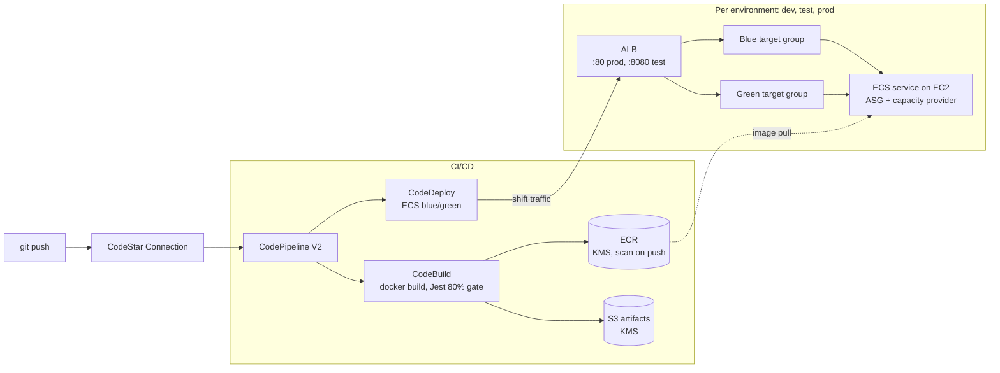
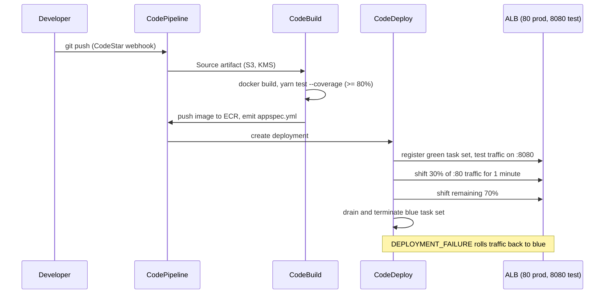

# Blue-Green Deployment with AWS Terraform

[](https://github.com/Sagargupta16/Blue_Green_AWS_Terraform/actions/workflows/ci.yml)
[](https://sonarcloud.io/summary/new_code?id=Sagargupta16_Blue_Green_AWS_Terraform)
[](LICENSE)

Infrastructure-as-Code for a multi-environment Blue/Green deployment pipeline on AWS. A single `terraform apply` provisions the network, registry, CI/CD, and three isolated ECS environments (dev, test, prod) for a containerized Node.js reference app.

**Why it exists:** shipping a new container version without downtime, with a way to test it on real infrastructure before users see it, and an automatic way back when it breaks. CodeDeploy runs the new version next to the old one, sends 30% of production traffic to it for a minute, then cuts over or rolls back.

## Architecture



- **ECS on EC2**: containerized application hosting with an Auto Scaling Group of container-instances (one cluster per environment)
- **Application Load Balancer**: per-environment ALB with two target groups (blue/green) and two listeners (`:80` prod traffic, `:8080` test traffic)
- **Auto Scaling Group + ECS Capacity Provider**: managed-scaling EC2 capacity for each cluster
- **CodePipeline (V2)**: two pipelines (`dev`, `main`) triggered by GitHub push via a CodeStar Connection
- **CodeBuild**: Docker image build, Jest test execution, 80% line-coverage gate, ECR push
- **CodeDeploy**: ECS blue/green with a custom `TimeBasedCanary` config (30% traffic for 1 min, then full cutover) and automatic rollback on failure
- **ECR**: KMS-encrypted image registry with scan-on-push
- **VPC**: 2-AZ network, 2 public subnets, 2 private subnets, 2 NAT gateways
- **IAM**: six scoped roles (instance / task execution / task / codebuild / codedeploy / codepipeline)
- **KMS**: single symmetric CMK (key rotation on) shared by ECR, CodeBuild, CodePipeline and CodeDeploy
- **S3**: artifact bucket for CodeBuild/CodePipeline (objects written by the pipeline are encrypted with the CMK)

## Features

- **Zero-downtime deployments** via CodeDeploy ECS blue/green (canary rollout + auto-rollback)
- **One build per pipeline run** in the main pipeline: test and prod deploy the same appspec and image tag (see [Known limitations](#known-limitations) for the mutable-tag caveat)
- **Per-environment isolation**: dev, test, and prod each get their own ECS cluster, ALB, and ASG
- **KMS-encrypted artifacts end-to-end** (ECR, CodeBuild, CodePipeline, CodeDeploy)
- **Least-privilege IAM**: pipeline role scoped to the services it actually uses (no `ec2:*` / `s3:*` wildcards); execution role and task role are separate identities
- **Consistent tagging** via `provider.default_tags`, no per-resource `tags =` plumbing
- **IMDSv2 enforced** on EC2 container-instances
- **X-Ray distributed tracing** (daemon sidecar + SDK middleware)
- **CI-side security scanning**: GitHub Actions runs Checkov + `terraform fmt/validate` on every PR
- **Dependency hygiene**: Renovate monthly grouped updates, SonarCloud analysis

## Design decisions

| Decision | Why | Trade-off |
|---|---|---|
| CodeDeploy blue/green, not ECS rolling update | Test listener (`:8080`) lets you hit the new task set before any user does; rollback is a listener swap, not a redeploy | `deployment_controller = CODE_DEPLOY` means no ECS deployment circuit breaker |
| `TimeBasedCanary` 30% for 1 min | Real production traffic validates the release before full cutover | One minute is short; raise `interval` or add CloudWatch alarms to the deployment group for real workloads |
| ECS on EC2, not Fargate | Shows the full container-instance story: launch template, IMDSv2, ASG, capacity provider | More moving parts than Fargate |
| One cluster + ALB per environment | Blast radius of a bad deploy stops at its environment | Three ALBs and six NAT-routed instances cost more than a shared cluster |
| Manual approval between test and prod | A human signs off on what ran in test | Pipeline waits on a person |
| Provider-level `default_tags` | Every taggable resource gets the same tags, no module plumbing | ASG `tag {}` blocks are the one exception AWS forces |
| Hand-rolled modules, no registry modules | Every resource is visible and explainable | More code to maintain than `terraform-aws-modules` |

## Prerequisites

- [Terraform](https://developer.hashicorp.com/terraform/install) >= 1.1.0 (AWS provider `~> 6.0`)
- [AWS CLI](https://aws.amazon.com/cli/) configured with credentials for the target account
- [Docker](https://www.docker.com/get-started) for local testing and image builds
- [Node.js](https://nodejs.org/) 20.19+ or 22.12+ for the reference app (Vite 8 needs it; the Dockerfile and `.nvmrc` use Node 24)
- [Yarn](https://classic.yarnpkg.com/) 1.x package manager
- A **CodeStar Connection** to GitHub, authorized in the AWS console. Its ARN is supplied via `github_connection_arn` in `terraform.tfvars`

## Installation

1. **Clone the repository**
   ```bash
   git clone https://github.com/Sagargupta16/Blue_Green_AWS_Terraform.git
   cd Blue_Green_AWS_Terraform
   ```

2. **Configure AWS credentials**
   ```bash
   aws configure
   ```

3. **Customize variables**
   Edit `terraform/terraform.tfvars`. At minimum set `github_connection_arn`, `github_owner`, `github_repo`, `main_branch_name`, `dev_branch_name`. Both branch names must exist in the GitHub repo the connection points at, or the pipelines never trigger.

4. **Initialize Terraform**
   ```bash
   cd terraform
   terraform init
   ```

> **State backend:** this project currently uses local state (`terraform/terraform.tfstate`). Do **not** use this layout for production. Move state to an S3 backend with a DynamoDB lock table, and never commit state files (they can contain secrets).

## Usage

### Deploy Infrastructure

```bash
cd terraform
terraform plan
terraform apply
terraform output          # prints the three ALB DNS names (dev / test / prod)
```

### Deploy Application

Pushes to the configured branches trigger the pipelines automatically:

- **dev branch** -> `dev` pipeline -> deploys to `dev` environment
- **main branch** -> `main` pipeline -> builds once -> deploys to `test` -> manual approval -> deploys to `prod`

```bash
git push origin <dev_branch_name>   # or main_branch_name
```

The manual approval step happens in the CodePipeline console.

### Local Development (reference app)

```bash
cd Test_App
yarn all-install     # installs backend + frontend, builds React client
yarn start           # starts Express on port 3000 (override with PORT)
yarn test            # Jest + Supertest
```

The app is available at <http://localhost:3000>.

## Project Structure

```
├── terraform/                    # Infrastructure as Code
│   ├── main.tf                   # Root module wiring
│   ├── variables.tf              # Input variables (validated)
│   ├── outputs.tf                # ALB DNS outputs per environment
│   ├── locals.tf                 # common_tags merged into provider default_tags
│   ├── data.tf                   # aws_caller_identity
│   ├── versions.tf               # Terraform + AWS provider pins, default_tags
│   ├── terraform.tfvars          # Your environment-specific values
│   ├── vpc/                      # VPC, subnets, IGW, NAT gateways, route tables
│   ├── security-groups/          # ALB & ECS security groups
│   ├── alb/                      # Per-env ALB + blue/green target groups + listeners
│   ├── asg/                      # Launch template + ASG + capacity provider
│   ├── ecs/                      # Per-env cluster + service + CW alarm (wraps alb/asg/security-groups)
│   ├── task_definition/          # ECS task definitions (app + X-Ray sidecar)
│   ├── codebuild/                # CodeBuild project (one per build env)
│   ├── codedeploy/               # CodeDeploy app + deployment group (one per env)
│   ├── codepipeline_dev/         # Dev pipeline (Source -> Build -> Deploy-Dev)
│   ├── codepipeline_main/        # Main pipeline (Source -> Build -> Deploy-Test -> Approval -> Deploy-Prod)
│   ├── ecr/                      # Private ECR repo (KMS-encrypted, scan-on-push)
│   ├── iam/                      # All IAM roles & inline policies
│   ├── kms/                      # Pipeline KMS CMK + alias
│   ├── s3/                       # Artifact bucket
│   └── codecommit/               # Deprecated (GitHub source replaced CodeCommit)
├── Test_App/                     # Express + React reference application
│   ├── buildspec.yml             # CodeBuild spec (alternate; the repo-root one is the active one)
│   ├── Dockerfile                # Multi-stage (client builder -> server)
│   ├── index.js                  # Express backend with X-Ray SDK
│   ├── package.json              # Also holds the Jest 80% coverage threshold
│   ├── client/                   # React frontend (Vite)
│   └── tests/                    # Jest + Supertest
├── .github/
│   └── workflows/
│       └── ci.yml                # Checkov + terraform fmt/validate (shared workflow)
├── buildspec.yml                 # Active CodeBuild spec (referenced by CodeBuild projects)
├── renovate.json                 # Monthly grouped dep updates
├── CHANGELOG.md
└── README.md
```

## Configuration

### Key Variables (defaults from `terraform/terraform.tfvars`)

| Variable | Description | Current value |
|---|---|---|
| `aws_region` | AWS region | `us-east-1` |
| `project_name` | Resource-name prefix | `blue-green-dep-app` |
| `vpc_cidr` | VPC CIDR | `10.0.0.0/16` |
| `availability_zones` | AZ pair for the subnets | `["us-east-1a", "us-east-1b"]` |
| `asg_ec2_instance_type` | Container-instance type | `t2.large` |
| `asg_desired_capacity` / `min` / `max` | ASG sizing | `2 / 2 / 4` |
| `task_definition_cpu` / `memory` | Task sizing | `256 / 512` |
| `container_port` | App port | `3000` |
| `main_branch_name` / `dev_branch_name` | GitHub branches that trigger the pipelines | `master` / `feature/modifications` (neither exists in this repo today, whose default branch is `main`; point them at real branches before applying) |
| `github_connection_arn` | ARN of the CodeStar Connection to GitHub | _set in tfvars_ |

### Tagging

All tags are applied once at the provider level via `default_tags`:

```hcl
provider "aws" {
  region = var.aws_region
  default_tags { tags = local.common_tags }
}
```

Modules do **not** accept or forward a `tags` variable. Every taggable AWS resource inherits the project tag set automatically. The only exception is the `aws_autoscaling_group`'s `tag {}` blocks, which AWS requires as a distinct construct.

## Blue-Green Deployment Flow



## Testing

```bash
cd Test_App
yarn test             # Jest + Supertest against the real index.js
yarn test --coverage  # coverage report; fails below 80% line coverage (CodeBuild runs this)
```

## Monitoring

- **CloudWatch Logs**: auto-created per task (app + X-Ray sidecar streams)
- **CloudWatch Metrics**: ECS ContainerInsights enabled on every cluster
- **CloudWatch Alarm**: `CPUReservation >= 60%` (note: `alarm_actions = []`, wire to SNS to make it actionable)
- **ALB health checks**: `GET /` every 30 s per target group
- **X-Ray**: distributed tracing via the `aws-xray-daemon` sidecar (pulled from ECR Public) + SDK middleware in the app

## Security

- **Scoped IAM**: CodePipeline role is scoped to the services it actually invokes (CodeStar Connections, CodeBuild, CodeDeploy, S3 artifact bucket, ECR describe, KMS, PassRole). The ECS task-execution role is distinct from the task role so image-pull and log-write are separated from application-level permissions.
- **IMDSv2 required** on the EC2 launch template.
- **KMS key rotation** enabled on the pipeline CMK.
- **ECR image scanning** on push.
- **ALB**: deletion protection, invalid-header drop.
- **Locked installs**: the Dockerfile runs `yarn install --frozen-lockfile --ignore-scripts`.
- **CI security scanning**: every push to `main` and every PR runs:
  - `terraform fmt -check -recursive` + `terraform validate`
  - Checkov, with SARIF output uploaded to GitHub Code Scanning. It runs with `soft_fail`, so findings are advisory and do not block a merge.

## Known limitations

Honest list of what a production version would change:

- **Mutable image tags.** Every build pushes `:<env>-latest`, and the task definitions point at that tag. If a second push to the main branch builds while an earlier run waits at manual approval, the earlier run deploys the newer image to prod. The fix is the `CodeDeployToECS` action with a `taskdef.json` + `imageDetail.json`, which registers a new task-definition revision pinned to the image digest per build.
- **Local Terraform state**, no S3 backend or lock table.
- **Amazon Linux 2 AMI.** `asg_ec2_ami_name` points at the AL2 ECS-optimized AMI; AL2 reached end of support on 2026-06-30. Switch to `/aws/service/ecs/optimized-ami/amazon-linux-2023/recommended/image_id`.
- **Public test listener.** `:8080` is open to `0.0.0.0/0` like `:80`; restrict it to your IP or VPN range.
- **No HTTPS.** Both listeners are HTTP; add an ACM certificate and a `:443` listener for real traffic.
- **Open Checkov findings** (S3 versioning/public-access block, ALB access logs, security-group descriptions, and similar) are tracked in GitHub Code Scanning.

## Troubleshooting

1. **Terraform state lock**: `terraform force-unlock <lock-id>`
2. **Pipeline stuck at Source or never triggers**: the CodeStar Connection status must be **Available** (re-authorize it in the AWS console if it is **Pending**), and `main_branch_name` / `dev_branch_name` must be branches that exist.
3. **CodeBuild hanging on `dockerd`**: the CodeBuild project already sets `privileged_mode = true`, and the buildspec still starts the Docker daemon manually. If the build hangs there, remove the two `dockerd` lines from the `install` phase.
4. **ECR push rejected with `ImageTagAlreadyExistsException`**: only happens if you switch the repository to `IMMUTABLE` without removing the `:<env>-latest` tag push from `buildspec.yml`.
5. **CodeDeploy rollback**: CodeDeploy rolls back automatically on `DEPLOYMENT_FAILURE`. To force a manual rollback, stop the deployment from the CodeDeploy console.
6. **Container-instances never join the cluster**: check `/var/log/cloud-init-output.log` on an instance; the launch-template user data must start with `#!/bin/bash` at byte 0 to write `ECS_CLUSTER` into `/etc/ecs/ecs.config`.

## Contributing

1. Fork and create a feature branch (`git checkout -b feature/my-change`)
2. Commit your changes (`git commit -m 'Describe the change'`)
3. Push the branch (`git push origin feature/my-change`)
4. Open a Pull Request. The GitHub Actions workflow will run Terraform checks and security scans automatically.

## License

MIT License, see the [LICENSE](LICENSE) file.

## Authors

- Sagar Gupta, [@Sagargupta16](https://github.com/Sagargupta16)

## Acknowledgments

- AWS documentation and reference architectures
- Terraform community modules
- Blue/Green deployment patterns popularized by the CodeDeploy-on-ECS integration
